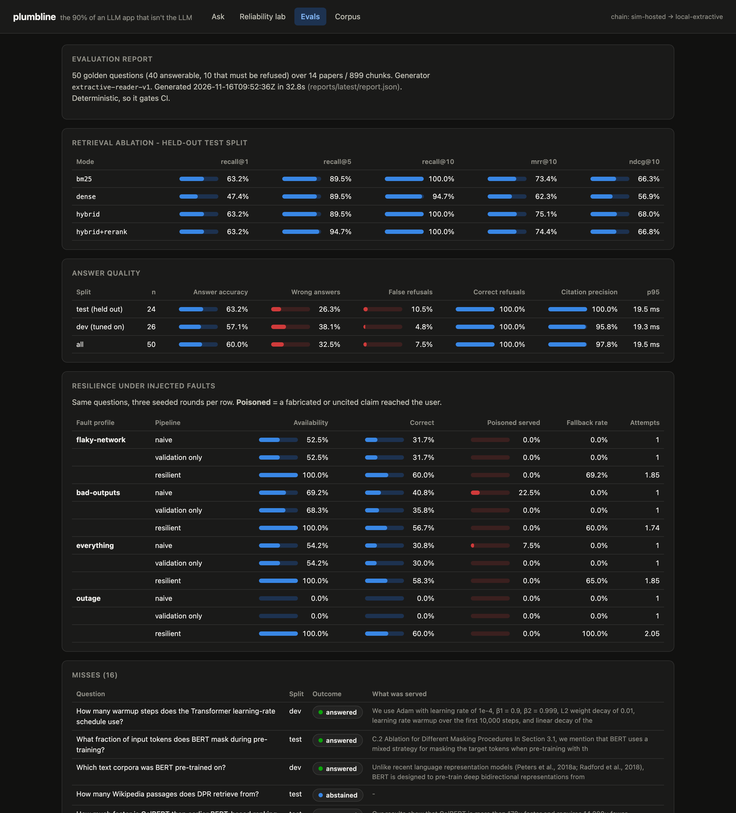

# plumbline

**The 90% of an LLM app that isn't the LLM.** A cited-answer RAG system over 14 AI research
papers where the model call is the smallest part: data processing, retrieval, output
validation, failure handling and evaluation are each built properly, measured, and wired
into one pipeline. Runs fully offline with no API key; hosted models plug in with an env var.


## What is in it

| Layer | What it does | Code |
|---|---|---|
| **Processing data** | arXiv fetch (resumable, checksummed), column-aware PDF parsing, header/footer removal, vocabulary-based de-hyphenation, caption-anchored extraction of borderless tables, section-aware chunking, quality gates (scanned-file and wrong-file detection, fragments, symbol soup, SimHash near-duplicates), incremental re-ingest | `src/plumbline/ingest/` |
| **Retrieving info** | BM25 + dense LSA retrieval, reciprocal rank fusion, feature reranker | `src/plumbline/retrieve/` |
| **Validating outputs** | tolerant JSON parsing, schema, citation integrity, verbatim-quote check, lexical support check, number grounding, prompt-injection screening of retrieved text; unsupported claims are removed before serving | `src/plumbline/validate/` |
| **Handling failures** | error taxonomy, per-attempt timeouts, jittered backoff honouring Retry-After, repair turn, circuit breakers, fallback chain, request deadline, seeded fault injector | `src/plumbline/resilience/`, `src/plumbline/llm/chaos.py` |
| **Evaluating** | 50-question golden set with a dev/test split, retrieval ablation, answer and refusal accuracy, resilience under injected faults, CI gate | `src/plumbline/evals/`, `evals/` |

## Results

Full report: [reports/baseline.md](reports/baseline.md). Deterministic and reproducible with `plumbline eval`.

- **Answers (held-out test split, offline extractive reader):** 63% answer accuracy, 100% of unanswerable questions refused, 100% citation precision, p95 20 ms.
- **Resilience (all faults injected):** availability 54% -> 100%, fabricated or uncited claims served 7.5% -> 0%. With bad outputs only: 22.5% -> 0%. Full primary outage: 0% -> 100% availability.
- **Retrieval (test split):** hybrid+rerank recall@5 0.95, MRR@10 0.74.

Honest notes: the default generator is an extractive baseline, so answers are quoted
sentences and roughly a third are off-target; a hosted model is expected to do better but
has not been run here (no API key was available). The reranker improves recall@5 but not
MRR on the test split. Grounding checks are lexical, not semantic. The test split is 19
answerable questions, so differences of a few points are noise.




## Run it

```bash
uv sync
uv run plumbline fetch      # downloads the 14 PDFs from arXiv (not redistributed here)
uv run plumbline ingest
uv run plumbline serve      # dashboard at http://127.0.0.1:8000
uv run plumbline ask "Which operator does ColBERT use to score a query against a document?"
uv run plumbline eval --gate
uv run pytest
```

Use a hosted model as the primary (the offline reader stays as the last fallback):

```bash
PLUMBLINE_PROVIDERS=anthropic uv run plumbline serve          # needs Anthropic credentials
PLUMBLINE_PROVIDERS=openai PLUMBLINE_OPENAI_BASE_URL=http://localhost:11434/v1 PLUMBLINE_OPENAI_MODEL=llama3 uv run plumbline serve
```

The Claude adapter defaults to `claude-opus-5-5` and enables server-side refusal fallback
(`PLUMBLINE_ANTHROPIC_SERVER_FALLBACK=0` turns it off). Both hosted adapters are covered by
tests against fakes only.

## License

MIT. PyMuPDF, used for PDF parsing, is AGPL-licensed.
