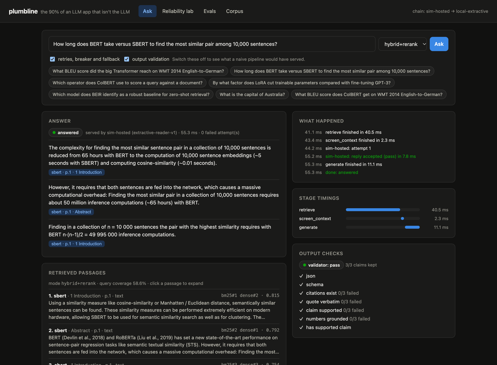
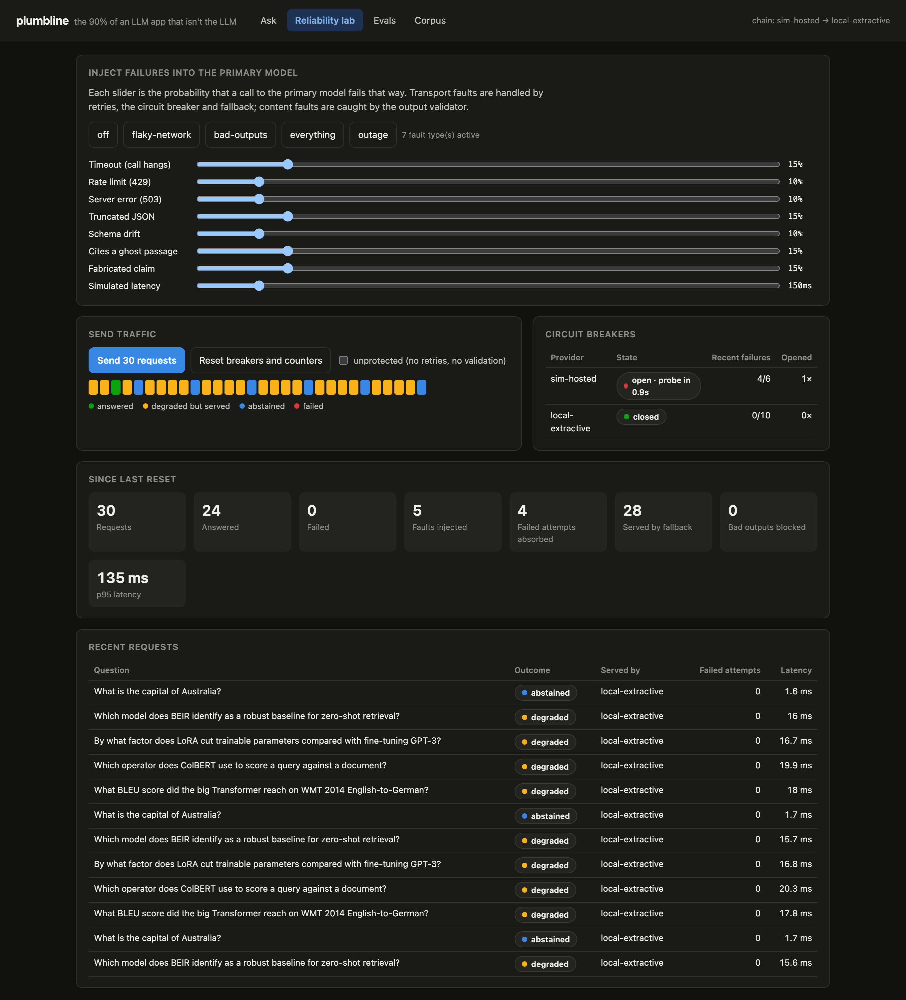

# plumbline

**The 90% of an LLM app that isn't the LLM.**

A question-answering system over 14 AI research papers where the model call is the
smallest part. Calling an LLM is one line; the real job is everything around it:
processing messy data, retrieving the right passage, validating what the model says,
surviving failures, and measuring all of it. plumbline builds each of those properly and
wires them into one pipeline you can run, break on purpose, and evaluate.

It runs fully offline with no API key. Hosted models plug in with one env var.



## Quickstart

```bash
uv sync
uv run plumbline fetch      # downloads the 14 PDFs from arXiv (not redistributed here)
uv run plumbline ingest     # parse, quality-check, chunk, index (~10 s)
uv run plumbline serve      # dashboard at http://127.0.0.1:8000
```

```bash
uv run plumbline ask "Which operator does ColBERT use to score a query against a document?"
uv run plumbline eval --gate    # all evaluations + the CI quality gate
uv run pytest                   # 82 tests, no network
```

Needs Python 3.11+ and [uv](https://docs.astral.sh/uv/).

## The five layers

| | What is built | Where |
|---|---|---|
| **Processing data** | Resumable, checksummed arXiv fetch. Column-aware PDF parsing, running-header removal, vocabulary-based de-hyphenation, caption-anchored extraction of borderless tables. Section-aware chunking. Quality gates: scanned-file and wrong-file detection, fragments, equation soup, SimHash near-duplicates. Incremental re-ingest by content hash. | [`ingest/`](src/plumbline/ingest) |
| **Retrieving info** | BM25 and dense (LSA) retrieval, reciprocal rank fusion, a feature reranker, and a retrieval gate that refuses to spend a model call on a question the library cannot answer. | [`retrieve/`](src/plumbline/retrieve) |
| **Validating outputs** | Tolerant JSON parsing, schema, citation integrity, verbatim-quote check, lexical support check, number grounding, and screening of retrieved text for injected instructions. Unsupported claims are removed and the answer rebuilt from what survives. | [`validate/`](src/plumbline/validate) |
| **Handling failures** | Error taxonomy (retryable or not), per-attempt timeouts, jittered backoff that honours Retry-After, one repair turn with the validator's findings, circuit breakers, a fallback chain, a whole-request deadline, and a seeded fault injector to prove it. | [`resilience/`](src/plumbline/resilience), [`llm/chaos.py`](src/plumbline/llm/chaos.py) |
| **Evaluating** | 50-question golden set with a dev/test split, a retrieval ablation, answer and refusal accuracy, resilience under injected faults with the protective layers on and off, and a threshold gate that fails CI. | [`evals/`](src/plumbline/evals), [`evals/golden.yaml`](evals/golden.yaml) |

How the pieces connect: [docs/architecture.md](docs/architecture.md).

## Results

All numbers are from `plumbline eval`, which is deterministic (offline models, seeded
faults). Full report: [reports/baseline.md](reports/baseline.md).

### What the resilience and validation layers are worth

The same 40 questions, three seeded rounds per row, with faults injected into the primary
model. *Poisoned* means a fabricated or uncited claim reached the user.

| Faults injected | Pipeline | Availability | Poisoned answers served |
|---|---|---:|---:|
| timeouts, 429s, 503s | naive (one call, trust the output) | 52.5% | 0.0% |
| | **plumbline** | **100.0%** | 0.0% |
| truncated JSON, schema drift, ghost citations, fabricated claims | naive | 69.2% | 22.5% |
| | **plumbline** | **100.0%** | **0.0%** |
| all of the above | naive | 54.2% | 7.5% |
| | **plumbline** | **100.0%** | **0.0%** |
| primary model fully down | naive | 0.0% | 0.0% |
| | **plumbline** | **100.0%** | 0.0% |



### Answer quality (offline extractive reader)

| Split | Answer accuracy | Wrong answers | False refusals | Unanswerable questions refused | Citation precision | p95 latency |
|---|---:|---:|---:|---:|---:|---:|
| test (held out, n=24) | 63.2% | 26.3% | 10.5% | 100% | 100% | 20 ms |
| dev (tuned on, n=26) | 57.1% | 38.1% | 4.8% | 100% | 95.8% | 19 ms |

### Retrieval ablation (held-out test split)

| Mode | recall@1 | recall@5 | recall@10 | MRR@10 |
|---|---:|---:|---:|---:|
| `bm25` | 0.632 | 0.895 | 1.000 | 0.734 |
| `dense` (LSA) | 0.474 | 0.895 | 0.947 | 0.623 |
| `hybrid` | 0.632 | 0.895 | 1.000 | 0.751 |
| `hybrid+rerank` | 0.632 | **0.947** | 1.000 | 0.744 |


### What the evals changed

The harness was written before the system was tuned, and it overturned three things:

- **The first abstention rule refused 62% of answerable questions.** It required the
  question's rarest word to appear in the passage, so any paraphrased verb triggered a
  refusal. It was replaced by a rule on named things only (capitalised names and numbers),
  which refuses "What BLEU score does ColBERT get on WMT 2014?" without refusing
  paraphrases.
- **The first reranker made top-1 retrieval worse than plain BM25.** A grid search on the
  dev split showed the fused first-stage rank deserved most of the weight and that two of
  the four lexical features deserved none. On the test split the tuned reranker improves
  recall@5 and is neutral on MRR. That is reported as measured, not rounded up.
- **The circuit breaker tripped too eagerly**, sending nearly all traffic to the fallback
  after a handful of faults. Its window and threshold were widened.

## Using a hosted model

The offline reader always stays as the last link of the fallback chain.

```bash
PLUMBLINE_PROVIDERS=anthropic uv run plumbline serve
```

```bash
PLUMBLINE_PROVIDERS=openai PLUMBLINE_OPENAI_BASE_URL=http://localhost:11434/v1 PLUMBLINE_OPENAI_MODEL=llama3.1 uv run plumbline serve
```

The Claude adapter uses the official SDK with a JSON-schema-constrained output, defaults to
`claude-opus-5-5`, and enables server-side refusal fallback
(`PLUMBLINE_ANTHROPIC_SERVER_FALLBACK=0` turns it off). See [.env.example](.env.example).

## Limits, stated plainly

- **The hosted adapters have not been run against a live API.** No key was available while
  building this. They are covered by tests against fakes (request shape, error mapping,
  repair turns), so expect to fix something small on first contact.
- **The default generator is an extractive baseline.** It quotes sentences rather than
  writing answers, and about a third of its answers are topical but off-target. Closing
  that gap is what a hosted model is for; the eval harness is ready to measure it.
- **Grounding checks are lexical, not semantic.** They catch fabricated quotes, wrong
  citations and invented numbers. A fluent paraphrase that inverts a passage could pass.
- **The eval set is small.** 40 answerable questions, 19 in the test split. Differences of
  a few points are noise.
- **PDF parsing is heuristic** and tuned on these 14 papers. Some glyphs are lost where a
  PDF's fonts lack a text mapping.

## Layout

```
corpus/manifest.yaml      the 14 papers
src/plumbline/
  ingest/                 fetch, parse, chunk, quality gates, pipeline
  retrieve/               bm25, dense, fusion, rerank, retriever
  llm/                    provider interface, extractive reader, Claude, OpenAI-compatible, chaos
  resilience/             errors, retry, breaker, fallback loop
  validate/               parse, schema, grounding, guards, validator
  evals/                  dataset, metrics, runner, report + gate
  api/                    FastAPI app and the dashboard
  pipeline.py             the request path
evals/                    golden set and CI thresholds
reports/baseline.md       the committed evaluation report
tests/                    82 tests
```

## License

MIT. PyMuPDF, used for PDF parsing, is AGPL-licensed; swap the parser if that matters for
your use. The papers remain under their authors' licenses and are downloaded from arXiv,
not redistributed.
