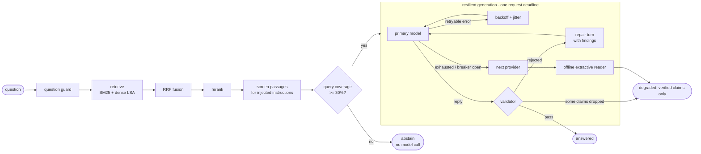
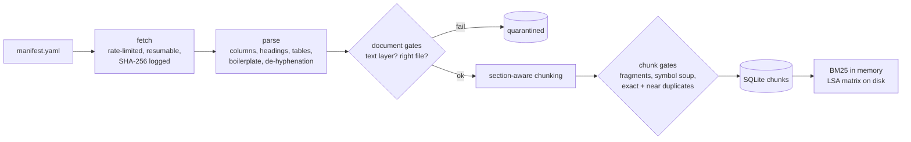

# Architecture

## The request path

`RagPipeline.answer` never raises for an operational failure. Every request ends in one of
four states, each with a full trace:

| Status | Meaning |
|---|---|
| `answered` | primary model, every claim verified |
| `degraded` | still served, but either unsupported claims were removed or a fallback provider answered |
| `abstained` | the library does not cover the question (retrieval gate, or the model said so) |
| `failed` | invalid question, or - with resilience switched off - the single attempt failed |

## Ingestion

Things the parser handles that a naive `page.get_text()` does not:

- **Silent data loss.** On one paper in the corpus (ColBERT, subset CID fonts) the styled
  extraction mode returns about 20% of the text with no error. Text is therefore always
  taken from the plain block extraction; the styled one is only consulted, by bounding-box
  overlap, for font size and weight.
- **Reading order.** Blocks straddling the gutter are bands; between bands the left column
  is read before the right.
- **Borderless tables.** The library's table finder returns nothing on booktabs tables, so
  tables are anchored on their `Table N:` caption, grown over adjacent non-prose blocks,
  and rows are rebuilt from word coordinates.
- **Hyphenation.** `representa-` + `tion` loses its hyphen and `pre-` + `trained` keeps it,
  decided by which spelling the document itself uses elsewhere.
- **Sections that hurt retrieval.** References and acknowledgements are skipped: they match
  many queries lexically and never answer one.

Re-ingestion is incremental: a document whose SHA-256 and pipeline version are unchanged is
loaded from its parse cache.

## Design decisions

**Offline first.** The default generator is a deterministic extractive reader and the dense
embedder is LSA fitted on the corpus. That costs answer quality, and buys three things: the
project runs for anyone with no key, CI can gate on evals because runs are reproducible,
and there is always a provider left at the end of the fallback chain.

**One contract for every provider.** All providers return raw text that must parse into the
same JSON shape (`answer`, `claims[] {text, citations, quote}`). The validator and the
resilience loop only know that contract, so adding a provider is one file.

**Retries live in one place.** SDK-level retries are disabled in the Claude adapter. Backoff,
breaker state and fallback are in `plumbline.resilience`, where they are traced and shared.

**Salvage before reject.** A reply with one fabricated claim among three good ones is served
as the two good ones, with the free-text answer rebuilt from them, rather than thrown away.

**Tune on dev, report on test.** The golden set is split by a hash of the question id.
Reranker weights and reader thresholds were chosen on dev; test numbers are only reported.

## Known limits

- Grounding checks are lexical. They catch fabricated quotes, citations to the wrong
  passage and invented numbers; a fluent paraphrase that inverts a passage could pass.
  An NLI model or LLM judge belongs at the same seam.
- The extractive reader picks sentences by term overlap, so it misses answers phrased
  differently from the question. That is the gap a hosted model is there to close.
- LSA is a weak dense retriever next to a trained embedding model. `Embedder` is the seam.
- 40 answerable questions is a small set; treat differences of a few points as noise.
- Traces, metrics and breaker state are in memory and per process.
